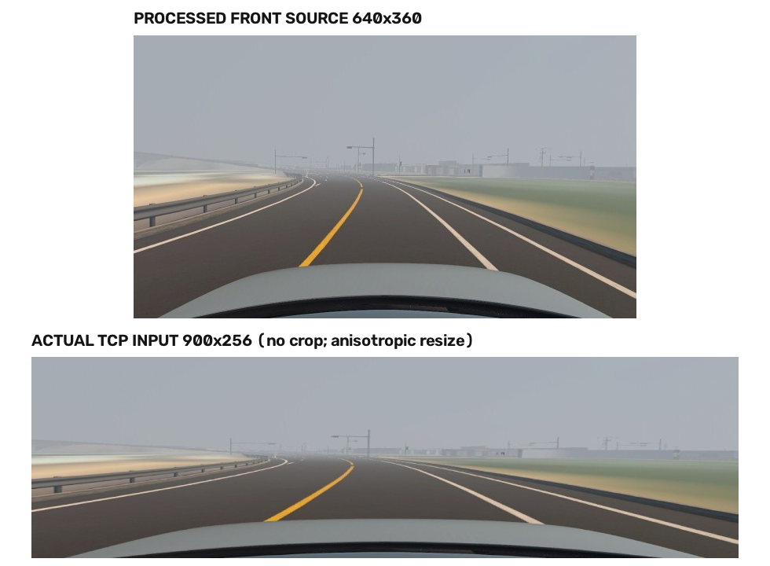
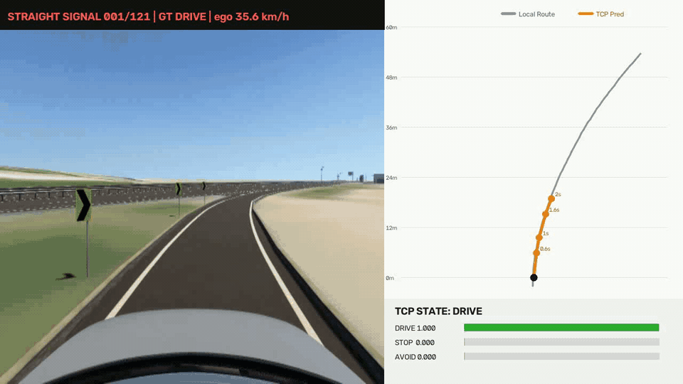

# Trajectory-Guided Imitation Learning in MORAI

CARLA에서 사전 학습한 **Trajectory-guided Control Prediction (TCP)** 정책을 MORAI K-City에 적용한 숭실대학교 ACCA 팀 프로젝트입니다. 정책은 전방 카메라 영상, 차량 속도, 경로 정보를 받아 **향후 2초의 웨이포인트**와 **조향·가감속 명령**을 함께 예측합니다. MORAI에서 수집한 사람 주행과 규칙 기반 주행으로 정책을 미세 조정하고, 기록 데이터에서의 예측 오차와 시뮬레이터 내 폐루프 주행을 평가했습니다.

## 내 기여

- 사람 주행과 규칙 기반 시연을 수집·라벨링했습니다. 카메라 타임스탬프를 기준으로 차량 상태, 경로, 제어 로그를 정렬하고 원본 주행 단위로 데이터를 분할했습니다.
- TCP의 입력 처리와 제어 예측을 MORAI 환경에 맞게 조정하고, 학습·추론·평가 파이프라인을 개발했습니다. 신호 대응과 장애물 회피처럼 드문 이벤트를 학습 배치에 포함했습니다.
- TCP 정책을 ROS 런타임에 통합했습니다. MPC와 로컬 경로 모듈은 팀원이 구현했습니다. [ACCA 팀 시스템](https://github.com/libok03/ACCA2026)

## 평가 결과

| 평가 | 평가 조건 | 보고된 결과 |
| --- | --- | --- |
| 오픈루프 궤적 예측 | 원본 주행 기준으로 분리한 테스트 세트 88개 주행, 44,562개 샘플 | **ADE 0.2924 m**, **2초 FDE 0.5225 m** |
| 폐루프 주행 | MORAI K-City에서 TCP의 조향·가감속 출력을 직접 적용 | **4랩 모두 완주**, 경로 오차 평균 **0.38 m**, RMSE **0.55 m** |
| 모델 추론 시간 | 팀 기술보고서의 신경망 추론 측정 | 평균 **11.02 ms**, p95 **18.05 ms** |

ADE는 예측 웨이포인트의 평균 위치 오차이고, FDE는 2초 지점의 위치 오차입니다. 오픈루프 평가에서는 장애물 회피 진입 구간의 ADE가 **0.7519 m**로 높았고, 해당 구간은 **40개 샘플**이었습니다. 폐루프 수치는 해당 시뮬레이터 시나리오와 기록된 주행에 해당합니다.

공통 평가 세트 36개 주행에서 CARLA 사전 학습 모델을 그대로 적용했을 때의 ADE는 **3.6045 m**, MORAI의 사람 주행과 규칙 기반 시연으로 학습한 최종 모델의 ADE는 **0.4069 m**였습니다. 데이터 구성과 학습 조건이 함께 달라진 비교입니다. 세부 지표와 공통 평가 세트의 표본 수 표기 차이는 [기술 문서](docs/technical-reference.md#동일-subset-모델-비교)에 정리했습니다.

## 데모

| TCP 영상 입력 예시 | DRIVE / STOP / AVOID 예측 |
| --- | --- |
|  |  |

기록된 ROS bag을 입력으로 사용한 **오픈루프 재생**입니다. [한 바퀴 재생](assets/tcp_full_policy_v1/videos/epoch_010_best_one_lap.mp4) · [DRIVE / STOP / AVOID 재생](assets/tcp_full_policy_v1/videos/epoch_010_drive_stop_avoid_full_camera.mp4)

## 코드와 재현

| 경로 | 내용 |
| --- | --- |
| [src/tcp_morai_finetune](src/tcp_morai_finetune) | TCP 모델, 데이터셋, 학습·평가 코드 |
| [scripts](scripts) | ROS bag 변환, 데이터 캐시 생성, 추론 도구 |
| [results](results) | 저장소에 포함된 실험 로그와 요약 |
| [tests](tests) | 단위 테스트와 스모크 테스트 |

[기술 문서](docs/technical-reference.md)에서 데이터 변환, 학습, 평가 실행 순서를 확인할 수 있습니다. 팀 보고서의 최종 수치를 다시 계산하려면 원본 ROS bag 또는 변환 데이터셋, 고정된 데이터 분할 목록, 체크포인트가 필요합니다. 전체 ROS 차량 스택의 위치 추정, 시뮬레이터 브리지, 안전 감시 모듈은 팀 시스템 문서에서 다룹니다.

**프로젝트** · 숭실대학교 ACCA, 2026 대학생 AI·S/W 모빌리티 경진대회 AI 융합 자율주행 부문
