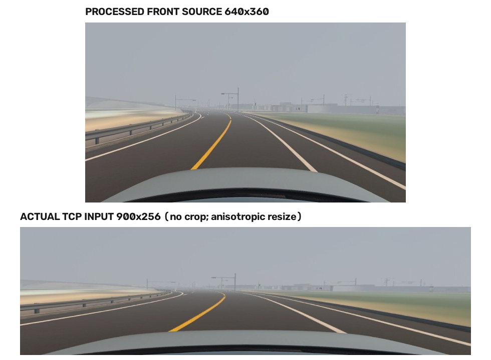
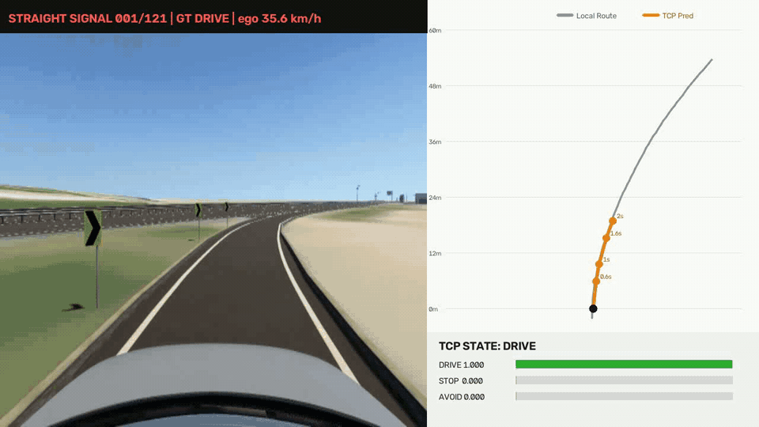

# ACCA MORAI Autonomous Driving — 기술 문서

MORAI K-City 환경을 위한 학습 기반 자율주행 시스템입니다. 전방 카메라 영상과 차량 상태,
MGeo에서 생성한 경로 조건을 입력받아 TCP(Trajectory-guided Control Prediction)가 미래 궤적과
차량 제어를 함께 예측합니다. GPS·IMU·Wheel 기반 위치 추정과 독립적인 Safety Monitor를 결합해
학습 정책의 출력이 실제 폐루프 주행으로 이어지도록 구성했습니다.

이 README는 **2026 대학생 AI·S/W 모빌리티 경진대회 ACCA 기술보고서**를 기준으로 프로젝트의
최종 설계와 평가 결과를 정리합니다. 저장소에는 학습·평가 및 데이터 변환 코드와 일부 결과가
포함되어 있으며, 대용량 ROS bag, 변환 데이터셋, pretrained checkpoint는 포함하지 않습니다.

[프로젝트 개요와 내 기여](../README.md)

## 핵심 결과

| 구분 | 결과 |
| --- | ---: |
| Held-out test | **ADE 0.2924 m**, **FDE@2 s 0.5225 m** |
| Current / future control MAE | 0.0392 / 0.0698 |
| TCP direct 폐루프 완주율 | **100.0%** · MORAI K-City 4랩 |
| TCP direct 경로 오차 | Mean 0.38 m / RMSE 0.55 m |
| Neural inference latency | 평균 11.02 ms / p95 18.05 ms |
| GPS+IMU+Wheel EKF 오차 | 일반 주행 구간 약 0.08-0.20 m |

> 위 결과는 MORAI의 제한된 K-City 시나리오에서 측정한 값입니다. 실제 도로 안전성이나 처음
> 보는 환경에서의 일반화를 보증하지 않습니다.

## 시스템 구성

```text
MORAI Simulator
  ├─ Front RGB 640x360 ───────────────────────────────┐
  ├─ Vehicle speed ───────────────────────────────────┤
  ├─ GPS + IMU + Wheel ── Local/Global EKF ──┐       │
  └─ Rear 3D LiDAR ──────────────────────────┼───────┼──────────┐
                                              │       │          │
                                              ▼       ▼          ▼
                                      MGeo route   TCP policy   Safety Monitor
                                          │            │          │
                              10 m target point        ├─ 4 future waypoints
                              30 m route command       ├─ current control
                                          │            └─ 4 future controls
                                          └────────────┬──────────┘
                                                       ▼
                                              Vehicle actuation
                                                       ▲
                                                       └─ E-STOP has priority
```

전체 시스템은 다음 세 계층으로 나뉩니다.

- **Localization**: GPS, IMU, wheel/vehicle state를 2차원 EKF로 융합해 ego odometry를 추정합니다.
- **Driving Model**: TCP가 전방 영상과 경로 조건으로 미래 궤적, 조향, 종방향 제어를 공동 예측합니다.
- **Safety Monitor**: 후방 LiDAR 충돌 위험과 센서 신호 두절을 감시하고 필요 시 E-STOP을 우선 적용합니다.

### 센서와 ROS 인터페이스

| 입력 | 역할 |
| --- | --- |
| Front RGB camera | 차선, 신호등, 장애물 등 전방 scene context |
| GPS | 장기 절대 위치 보정 |
| IMU | yaw rate 기반 자세·운동 추정 |
| Vehicle state / wheel | 속도와 dead reckoning 입력 |
| Rear 3D LiDAR | 후측방 차량 검출과 TTC 계산 |

MORAI의 UDP packet은 timestamp와 frame ID를 포함한 ROS message로 변환해 각 모듈에 전달합니다.
Localization은 주행 모델에 경로 조건을 제공하고, Safety Monitor는 주행 모델과 독립적으로 차량
제어를 중단할 수 있습니다.

## 위치 추정과 경로 조건화

### Local / Global EKF

K-City를 고저차가 작은 평면 환경으로 보고 상태를 `(x, y, yaw)`로 정의합니다.

- **Local EKF**는 IMU yaw rate와 차량 속도로 연속적인 odometry를 생성합니다.
- **Global EKF**는 GPS 관측을 추가해 장기 drift를 보정합니다.
- GPS blackout 동안에는 IMU와 wheel 기반 dead reckoning을 사용합니다.
- GPS 복구 또는 respawn으로 큰 위치 도약이 감지되면 수신한 절대 위치로 재초기화합니다.

### MGeo 경로 표현

전역 경로 전체를 모델에 넣지 않고 현재 pose 이후의 경로를 ego 좌표계로 바꾼 뒤 두 가지 조건으로
축약합니다.

| 경로 조건 | 정의 | 목적 |
| --- | --- | --- |
| Target point | 누적 경로 거리 약 10 m의 2D goal | 근거리 기하 유도 |
| High-level command | 최대 30 m route context에서 계산 | 장거리 navigation intent |

High-level command는 `LEFT`, `RIGHT`, `STRAIGHT`, `LANEFOLLOW`로 구성합니다. 30 m 구간의 곡률과
MGeo traffic-light node를 이용해 명령을 정하고, 동일한 영상에서도 목적 경로에 맞는 행동을 선택할
수 있도록 합니다.

## TCP 주행 정책

TCP는 하나의 ResNet34 visual encoder를 공유하는 trajectory branch와 control branch를 사용합니다.
CARLA pretrained TCP checkpoint는 초기 가중치로만 사용하며, MORAI demonstration으로 전체
policy를 supervised fine-tuning합니다. 별도의 frozen teacher, feature/value distillation, teacher
action KL은 사용하지 않습니다.

```text
Front RGB 640x360 ── ResNet34 ── visual feature ───────────┐
                                                         │
Speed + target point + command ── measurement MLP ───────┤
                                                         ▼
                                    ┌─ Trajectory GRU
                                    │    └─ waypoints at 0.6/1.0/1.6/2.0 s
                                    │
                                    └─ Spatial attention + Control GRU
                                         ├─ current acceleration / steering
                                         └─ 4-step future acceleration / steering
```

| 항목 | 구성 |
| --- | --- |
| 영상 입력 | 전방 RGB, 640x360 종횡비 유지 |
| 상태 입력 | current speed |
| 경로 입력 | 약 10 m target point, 30 m high-level command |
| 궤적 출력 | 0.6 / 1.0 / 1.6 / 2.0 s의 4개 ego-relative waypoint |
| 제어 출력 | 현재 및 미래 steering / signed acceleration |
| 제어 분포 | Beta distribution의 `alpha`, `beta` |

원본 TCP의 `8x29` attention grid는 실제 feature map 크기로 bilinear interpolation한 뒤 합이 1이
되도록 다시 정규화합니다. 따라서 640x360 영상을 900x256으로 강제 변형하지 않고 원래 종횡비를
유지합니다.

## 데이터 생성과 학습

### PDM-Lite teacher와 human demonstration

CARLA와 MORAI 사이의 영상, 도로 기하, 신호 체계, 차량 거동 차이를 줄이기 위해 MORAI에서 직접
demonstration을 수집했습니다.

- **PDM-Lite teacher**: MGeo 전역 경로와 kinematic bicycle MPC를 이용해 반복 가능한 nominal
  behavior를 생성합니다.
- **Human driving**: teacher만으로 얻기 어려운 off-nominal 상태와 복구 주행을 보완합니다.
- **신호 대응**: 국내 신호 전이 규칙에 따라 정지, 대기, 재출발 상황을 생성합니다.
- **장애물 대응**: 정적 장애물은 우회하고, 동적 장애물은 위험이 해소될 때까지 정지합니다.

카메라 frame timestamp를 기준으로 vehicle state, localization, route, control을 정렬합니다. Split은
sample이 아닌 source run 단위로 고정해 같은 원본 주행에서 파생된 구간이 train과 test에 동시에
들어가는 것을 방지합니다.

### 최종 데이터셋

| Split | Processed runs | Samples |
| --- | ---: | ---: |
| Train | 817 | 444,048 |
| Validation | 88 | 51,794 |
| Test | 88 | 44,562 |
| **합계** | **993** | **540,404** |

Checkpoint 선택에는 validation split만 사용하고 test split은 최종 평가에만 사용했습니다.

### Hard-event rebalancing

희소한 신호·회피 상황이 일반 주행에 묻히지 않도록 mini-batch를 다음 목표 비율로 구성합니다.

| 범주 | 목표 비율 |
| --- | ---: |
| AVOID approach | 20% |
| AVOID active | 25% |
| Signal DRIVE | 20% |
| Signal STOP | 15% |
| General replay | 20% |

### Loss와 학습 설정

```text
L = L_waypoint + 0.05 L_speed + 0.5 L_current + 0.5 L_future
```

Waypoint와 speed에는 L1 loss, 현재·미래 control에는 Smooth L1 loss를 사용합니다. Beta 분포의 평균을
`[-1, 1]` 범위의 deterministic action으로 변환해 ground truth와 비교합니다.

| 항목 | 설정 |
| --- | --- |
| Initialization | CARLA pretrained TCP |
| Selected checkpoint | Epoch 26 |
| Batch size | 80 |
| Head learning rate | `1e-4` |
| Backbone learning rate | `1e-5` |
| Weight decay | `1e-6` |
| Gradient clipping | 5.0 |
| Optimizer / scheduler | AdamW / CosineAnnealingLR |

## 평가 결과

### Held-out open-loop test

| 지표 | 결과 |
| --- | ---: |
| ADE / FDE@2 s | **0.2924 m / 0.5225 m** |
| Current / future control MAE | 0.0392 / 0.0698 |
| 0.6 / 1.0 / 1.6 / 2.0 s trajectory error | 0.0993 / 0.1852 / 0.3627 / 0.5225 m |
| Signal STOP ADE | 0.1724 m |
| Signal DRIVE ADE | 0.3116 m |
| General replay ADE | 0.2966 m |
| AVOID ADE | 0.4563 m |
| AVOID approach ADE | 0.7519 m |

AVOID approach는 40 samples로 표본 수가 작으므로 절대 성능 비교에 주의해야 합니다.

### 동일 subset 모델 비교

Side camera와 LiDAR가 모두 존재하는 36 runs의 공통 test subset에서 비교했습니다.

| 모델 | ADE | FDE@2 s |
| --- | ---: | ---: |
| **TCP** | **0.4069 m** | **0.6917 m** |
| SimLingo-Base | 1.0468 m | 2.0688 m |
| TransFuser | 1.3495 m | 2.2013 m |

보고서 7.1절은 2,619개 샘플, 7.2절은 26,190개 샘플로 표기합니다. 이 비교에서 확인되는
평가 단위는 공통 주행 36개입니다. 정확한 샘플 수는 평가에 사용한 고정 데이터 목록에서
확인해야 합니다.

### Domain adaptation

| 학습 조건 | 공통 subset ADE |
| --- | ---: |
| CARLA pretrained zero-shot | 3.6045 m |
| MORAI basic supervised fine-tuning | 0.7189 m |
| Teacher-only + hard-event | 1.1569 m |
| Human/PDM mixed, Epoch 4 | 0.4675 m |
| **Human/PDM mixed, Epoch 26** | **0.4069 m** |

각 checkpoint는 데이터 구성과 학습 전략이 함께 다르므로, 이 표는 단일 요인의 독립적인 ablation이
아니라 학습 조건별 비교입니다.

### Closed-loop controller 비교

각 controller는 MORAI에서 4 laps를 주행했으며, 기록된 ROS bag 기준으로 비교했습니다.

| 제어 방식 | 완주율 | Mean error | RMSE | Max error | Std |
| --- | ---: | ---: | ---: | ---: | ---: |
| **TCP direct** | **100.0%** | **0.38 m** | **0.55 m** | 3.08 m | **0.38 m** |
| Stanley on TCP trajectory | **100.0%** | 0.72 m | 0.83 m | 3.00 m | 0.41 m |
| MPC on TCP trajectory | 85.2% | 0.59 m | 0.74 m | 2.78 m | 0.45 m |
| Pure Pursuit on TCP trajectory | 69.9% | - | - | - | - |

최대 오차는 주로 장애물 회피를 위해 기준 경로를 벗어난 구간에서 발생했습니다. 한정된 로그의
완주 결과이므로 여러 seed와 새로운 장애물 배치를 사용한 추가 폐루프 평가가 필요합니다.

### Localization 비교

- GPS+IMU+Wheel EKF는 일반 주행에서 약 0.08-0.20 m 오차를 유지했습니다.
- 약 11 s GPS blackout에서 누적 횡오차는 Pure Wheel 17.78 m·s, Kinematic State 16.08 m·s,
  NDT+Wheel 11.77 m·s였습니다.
- NDT는 10 Hz 기준 평균 연산 예산의 181.1%를 사용하고 0.12 s 초과 비율이 63.9%였습니다.
- FAST-LIO와 KISS-ICP는 개활지의 부족한 기하 특징으로 크게 발산했습니다.

일부 blackout 구간에서 NDT가 더 낮은 누적 오차를 보였지만, 실시간 deterministic update를 우선해
최종 시스템은 경량 EKF를 사용했습니다.

## Safety Monitor

주행 모델은 전방 카메라만 보기 때문에 후측방 접근 차량과 센서 두절을 독립 모듈에서 감시합니다.

### 후방 LiDAR와 TTC

1. ROI crop, RANSAC ground removal, wall removal, voxel downsampling을 수행합니다.
2. KD-tree Euclidean clustering으로 객체 후보를 생성합니다.
3. Ego motion을 보정하고 Alpha-Beta filter로 위치와 속도를 추정합니다.
4. MGeo 차선 중심선의 Frenet 좌표에서 횡·종방향 점유 시간 구간을 계산합니다.
5. 두 구간이 3 s prediction horizon 안에서 겹치면 충돌 위험으로 판정합니다.

충돌 판정이 2 frames 연속 성립하면 E-STOP을 발행하고, 5 frames 연속 안전할 때 해제합니다. 정지
중 재출발은 4.0 m/s를 가정해 위험 판정이 불필요하게 해제되지 않도록 합니다.

### 센서 watchdog

IMU, LiDAR, vehicle speed의 마지막 수신 시각을 감시합니다. 기준 주파수를 `f_i`, 허용 결손 주기
수를 `k`라 할 때 timeout은 `T_i = k / f_i`입니다. 모든 신호가 한 번 이상 정상 수신되기 전에는
시스템을 ready로 전환하지 않으며, 주행 중 timeout이 발생하면 E-STOP을 발행합니다.

## 저장소 구조

```text
VLA_Driving/
├─ src/
│  ├─ tcp_morai_finetune/              # TCP 모델, dataset, full-policy 학습·평가
│  ├─ multimodal_planner_v17_spatial30/ # 이전 V17 멀티모달 실험 계보
│  └─ vla_driving/                      # 경량 baseline, perception, planning, control
├─ scripts/                             # ROS bag 변환, cache 생성, 학습·추론 도구
├─ configs/                             # baseline 실험 설정
├─ results/                             # 저장소에 포함된 TCP 실험 요약
├─ assets/                              # 정성 평가 이미지와 영상
└─ tests/                               # 단위·smoke tests
```

보고서가 설명하는 **전체 ROS 차량 스택** 가운데 EKF localization, MORAI UDP bridge, rear-LiDAR
Safety Monitor, E-STOP arbitration은 이 저장소에 완전한 실행 패키지로 포함되어 있지 않습니다.
이 저장소에서 직접 재현 가능한 범위는 주로 TCP 데이터 변환, 모델 학습·평가와 이전 planner
실험입니다.

## 설치

Python 3.10 이상과 CUDA를 지원하는 PyTorch 환경을 권장합니다.

```bash
git clone https://github.com/libok03/VLA_Driving.git
cd VLA_Driving

python -m venv .venv
source .venv/bin/activate          # Windows: .venv\Scripts\activate
python -m pip install --upgrade pip
python -m pip install -e '.[morai]'
```

## 재현 방법

### 1. Teacher bag 변환

```bash
python scripts/build_tcp_teacher_dataset.py \
  --bag-dir /path/to/teacher_bags \
  --output /path/to/teacher_processed \
  --control-cache /path/to/teacher_controls
```

### 2. Human / teacher dataset view 결합

```bash
python scripts/build_tcp_combined_dataset_view.py \
  --human-root /path/to/human_processed \
  --human-split /path/to/human_split.json \
  --human-controls /path/to/human_controls \
  --teacher-root /path/to/teacher_processed \
  --teacher-split /path/to/teacher_processed/split.json \
  --teacher-controls /path/to/teacher_controls \
  --output-root /path/to/combined_data \
  --output-controls /path/to/combined_controls
```

### 3. TCP full-policy fine-tuning

```bash
python -m tcp_morai_finetune.train_full_policy \
  --data-root /path/to/combined_data \
  --split-manifest /path/to/combined_data/split.json \
  --control-cache /path/to/combined_controls \
  --init-checkpoint /path/to/carla_pretrained_tcp.pt \
  --output-dir /path/to/training_output \
  --epochs 26 \
  --batch-size 80 \
  --num-workers 8 \
  --sampling-profile hard-events \
  --selection-profile hard-events \
  --hard-event-fractions 0.20 0.25 0.20 0.15 0.20
```

### 4. Split별 평가

```bash
python -m tcp_morai_finetune.evaluate_full_policy_by_state \
  --checkpoint /path/to/best.pt \
  --data-root /path/to/combined_data \
  --split-manifest /path/to/combined_data/split.json \
  --control-cache /path/to/combined_controls \
  --split test \
  --output /path/to/test_metrics.json \
  --batch-size 80
```

### 5. 저장소 테스트

```bash
python -m pytest
```

대용량 입력은 `.gitignore`의 `raw_bags/`, `data/`, `checkpoints/`, `outputs/` 아래에서 별도로
관리하십시오. 재현에는 공개 TCP initialization checkpoint와 보고서 평가에 사용한 split manifest가
추가로 필요합니다.

## 정성 결과

| 실제 TCP 입력 예시 | Open-loop DRIVE / STOP / AVOID |
| --- | --- |
|  |  |

- [한 바퀴 open-loop 추론 영상](../assets/tcp_full_policy_v1/videos/epoch_010_best_one_lap.mp4)
- [DRIVE / STOP / AVOID open-loop 추론 영상](../assets/tcp_full_policy_v1/videos/epoch_010_drive_stop_avoid_full_camera.mp4)

위 영상은 recorded bag replay이며 실제 차량 상태에 모델 출력을 되먹임한 closed-loop 결과와
구분해야 합니다.

## 참고 문헌

1. P. Wu et al., “Trajectory-guided Control Prediction for End-to-end Autonomous Driving: A Simple yet Strong Baseline,” NeurIPS, 2022.
2. J. Beißwenger, “PDM-Lite: A Rule-Based Planner for CARLA Leaderboard 2.0,” University of Tübingen, 2024.
3. MORAI, “MORAI SIM / MGeo Documentation,” MORAI SIM User Manual.
4. K. Chitta et al., “TransFuser: Imitation with Transformer-Based Sensor Fusion for Autonomous Driving,” TPAMI, 2023.
5. K. Renz et al., “SimLingo: Vision-Only Closed-Loop Autonomous Driving with Language-Action Alignment,” CVPR, 2025.

## 팀

**ACCA · 숭실대학교**

2026 대학생 AI·S/W 모빌리티 경진대회 AI 융합 자율주행 부문
